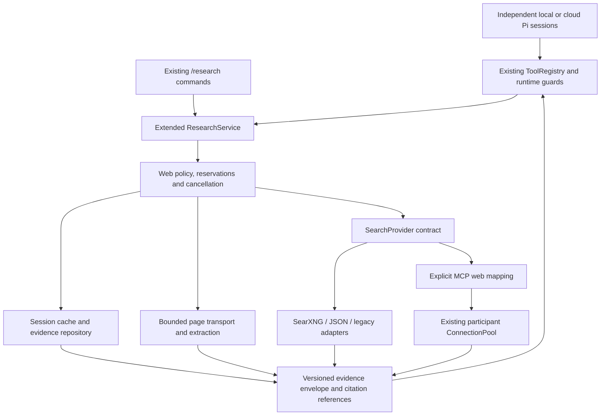

# Web Intelligence design and implementation plan

Date: 2026-10-20. Audit/planning status: **proposal recorded before implementation**. The subsequent [Phase 2 implementation](WEB_INTELLIGENCE_PHASE_2.md) documents delivered interfaces, narrower verification semantics, current configuration and remaining extensions. The confirmed audit below describes the pre-implementation working tree.

Canonical implementation state remains [STATUS.md](../STATUS.md). This plan extends the existing [architecture](ARCHITECTURE.md), [Sprint 2 research interfaces](SPRINT_2.md#research-and-memory), and [roadmap](ROADMAP.md). It does not authorize deployment, provider purchases, or changes to agent identities. Source inspected: working tree based on `aaaedd5`, version `0.2.0-dev.16`, including pre-existing uncommitted changes. Installed-release claims in STATUS.md are historical evidence, not a new installation check.

## 1. Confirmed current architecture

These are repository facts, confirmed from source on 2026-10-20. Proposed behavior starts in section 3. Some earlier paragraphs in ARCHITECTURE.md, TOOLS.md and SECURITY.md predate delivered MCP OAuth, pooling and document extraction; source and the later Sprint 2 sections are authoritative for this investigation.

| Area | Confirmed implementation and evidence |
| --- | --- |
| Runtime | A local Node >=24 ESM/TypeScript process. `Engine` in [engine.ts](../src/engine.ts) owns membership, delivery, scheduling, limits and controls; each participant has a UUID and its own Pi `AgentSession`/JSONL directory. SQLite `Repository` in [storage.ts](../src/storage.ts) owns shared state, events, transactions and tool receipts. The CLI and Ink UI are adapters. |
| Model providers | [providers.ts](../src/providers.ts), `ProviderRegistry`, wraps pinned Pi 1.1.0 `ModelRuntime`, catalog/auth and explicitly configured compatible endpoints. Custom aliases use the OpenAI-compatible completions protocol, including loopback endpoints without real credentials. Remote compatible endpoints require an environment key reference. Admission validates a nonce tool call and subsequent tool-result receipt. Supporting an endpoint does not prove every model on it can use tools. |
| Context isolation | [pi-adapter.ts](../src/pi-adapter.ts), `PiAdapter.create`, supplies an explicit resource loader, custom tools and separate session paths. Automatic Pi tools, project instruction discovery, extensions, skills and other applications' credential stores are excluded. Provider runtime/auth may be shared; model conversations are not. |
| Shared tools | [tools.ts](../src/tools.ts), `ToolRegistry`, owns named TypeBox schemas, owner/version metadata, permissions, active tool selection, execution, call identity, prepared/committed operation receipts and audit. `ToolProvider` and `ToolExecutor` are extension contracts; engine construction calls the existing installers. |
| Permissions | `Engine.authorized` rereads the agent and requires active membership plus both participant capability and session ceiling. `roundtable_tool_request` creates a pending approval; `Engine.decide` is human-controlled and does not automatically execute the denied call. Default participant capabilities exclude network access. Stage, human-wait, peer-wait, work and uncertain-operation guards also constrain execution. |
| MCP | [network-tools.ts](../src/network-tools.ts) registers discovery, call and resource tools. [connections.ts](../src/connections.ts) owns enabled HTTP/stdio configurations, exact tool/resource allowlists and `ConnectionPool`; [mcp-auth.ts](../src/mcp-auth.ts) handles Roundtable-owned OAuth. Schemas are discovered and input validated before invocation. Leases are per participant/server/configuration/credential, maximum 32, with 60-second idle expiry and a 20-second operation watchdog. Request timeout is 15 seconds; HTTP messages are bounded to 64 KiB. Failed invocations are not replayed automatically. Stdio programs remain trusted OS-user processes. |
| Configuration/CLI | `ROUNDTABLE_HOME` or the explicit user data-directory setting selects the private runtime. `research.json`, `mcp.json`, `endpoints.json` and `settings.json` have separate owners. [research-ui.ts](../src/research-ui.ts) and [cli.ts](../src/cli.ts) provide `/research settings`, `search`, `fetch`, `sources`, `clear-cache`; `/mcp`, `/tools`, `/activity`, `/budget` and `/endpoints` already exist. Human research commands call the service directly rather than impersonating an agent through ToolRegistry. |
| Dependencies | Node fetch/AbortSignal/crypto/SQLite, Zod, TypeBox, Pi AI/coding-agent/MCP, `saxes`, `pdfjs-dist`, `fflate`, Ink/React are already pinned. There is no dedicated HTML readability parser or browser automation dependency in package.json. XML/document dependencies do not establish robust HTML extraction. |

### Tool discovery to continued reasoning

1. `Engine.deliver` selects one participant's adapter and sends the human request, incoming delivery, assignment and permitted context. It starts a turn timeout. One delivery runs per participant; multiple participants can run concurrently.
2. `PiAdapter.create` translates registry definitions with `piTools`. `activeNames` filters authorization, configuration and blind-stage policy. `PiAdapter.prompt` refreshes active schemas before every prompt. Ordinary participants can discover metadata through `roundtable_tools_list`, including unconfigured/approval-required tools, without receiving credentials.
3. The selected Pi model emits a structured tool call. Pi calls the custom tool's `execute(callId,args,signal)`, which delegates to `ToolRegistry.execute` with participant identity and cancellation.
4. The registry deduplicates identical in-flight **call IDs**, checks identity collisions and durable receipts, enforces guards/capabilities/budgets, records a prepared operation, then runs the handler. The handler performs service-specific checks such as allowed origins or MCP tool names.
5. Results are redacted, persisted with a committed operation and `tool_result` event, and emitted as activity. Success is `{ok:true,data}`; thrown failures become `{ok:false,data:<redacted message>}`. `piTools` supplies JSON text, `details` and `structuredContent` to Pi. The current wrapper does not explicitly set a Pi error flag; agents are instructed to inspect `ok`. Raw MCP results may also contain their own error status inside an outer successful wrapper.
6. Pi places the result into that participant's conversation and continues the model tool loop. The wrapped stream meters each additional model request; assistant completion records usage/text. Independent provider fixtures in `provider.test.ts` exercise result consumption and continuation. Production HTTP/SSE transport fixtures in `transport.test.ts` exercise protocol serialization, but are not live inference servers.

Coding assignments additionally use `collaborationTools` in [code-collaboration.ts](../src/code-collaboration.ts): transient workflow stages expose a narrower list that currently omits web tools. Blind exploration has another allowlist in [policy.ts](../src/policy.ts). Neither should be bypassed by adding web functionality. No fixed production agent identities or new mandatory roles are needed.

## 2. Existing web capabilities and gaps

| Existing path | Confirmed behavior | Gap to address |
| --- | --- | --- |
| `web_search` | `ResearchService.run('search')` in [research.ts](../src/research.ts): configured SearXNG GET (`q`, `format=json`) or JSON POST `{query}`. Validates `{results:[{url,title,content}]}`, selects up to 10 sources, limits excerpts to 4,000 characters. Optional token comes from named environment variable. | Adapter is a configuration branch, not an explicit interchangeable contract. No query filters, provider capabilities, publication dates, query normalization, in-flight query sharing or search-specific budget. |
| `web_fetch` | Same service with `fetch`: exact human-approved HTTP(S) origins, no cookies/authorization headers, redirects or JavaScript. 15-second signal deadline, streamed response cap 1 MiB, supported text/HTML/JSON/XML MIME types, 16,000-character extracted text. HTML cleanup removes script/style/noscript and tags with regular expressions. | No readable article/section extraction, source-level snapshot IDs, locators, date confidence, content-type-specific extraction warnings, public-web address policy or rendered browsing. Regex cleanup is not an injection boundary. |
| Research snapshots/cache | `research` SQLite entities retain sources, retrieval/expiry timestamps, record hash and cache flag. Default TTL 900 seconds, allowed 0–86400. Key includes exact input/mode/configuration and, for search, selected credential value through a hash. Cache is session-scoped. `fresh:true` bypasses service cache. Origin validation happens before fetch cache lookup. | No semantic/query normalization, concurrent request coalescing, freshness maximum age, validators, source-level content hashes or retention quota. Cache lookup scans session records. TTL expiry does not delete records. `clear-cache` deletes research entities, not historical tool receipts/transcripts/events. |
| `web_research` | Legacy fixed endpoint from `ROUNDTABLE_RESEARCH_URL`, optional service token, POST `{query}`, 15 seconds, redirects denied, maximum 64 KiB JSON response. Same `network.research` permission. | Arbitrary returned JSON, separate implementation, no research snapshot contract or service cache. Preserve compatibility while adapting explicitly to the shared service. |
| MCP web tools | Existing configured MCP servers can expose search, fetch or browser tools through `mcp_tools_list`/`mcp_call`. | No repository-defined web adapter mapping or normalized provenance. MCP tool names/annotations alone do not establish read-only behavior. A remote server controls its own network access. |
| Other retrieval | Shared thread/note/FTS memory, artifacts, human-selected attachment/document extraction, host/project search and optional `project_relevance` exist. | These are local/project evidence paths, not internet search. Reuse storage, bounded extraction and redaction patterns; do not replace them or make web depend on a judgment model. |

### Current limits, logging and failure semantics

- `Limits` in [domain.ts](../src/domain.ts) defaults to 100 model requests, 300 tool calls, 100 exchanges, concurrency 3, queue 200, session timeout 900,000 ms, turn timeout 120,000 ms, optional token ceiling and estimated $10 model spending ceiling. Provider request caps are model-provider caps. **Search HTTP calls, web bytes and search-provider charges have no dedicated accounting.**
- The registry consumes global tool calls before a new handler invocation. Durable call-ID replay can return a receipt without another handler or tool count. Receipts have no research TTL. `fresh:true` does not override a previously completed identical call ID. Research-configuration changes alter web fingerprints; authorization is rechecked for cached receipts. Configuration health is labeled unprobed.
- `tool_start` includes inputs; `tool_result` includes returned content. `research_retrieved` records snapshot ID/hash/mode. Repository events and tool results use `redact`; some entity persistence relies on caller-side redaction. `redact` recognizes common tokens, secret-named environment values and values registered with `protectSecret`. It is heuristic, not a general sensitive-query or signed-URL detector. No uniform web latency/cache/byte/status metrics exist.
- Network handlers have their own deadlines; there is no universal registry handler timeout. Engine cancellation/turn/session deadlines surround model work. A timeout cannot prove a remote operation did not happen. Generic string errors do not distinguish empty results, denied access, bad schema, rate limits, cancellation, freshness failure and backend failure. There is no automatic research retry/fallback.
- Existing private/internal origins can deliberately be approved. Current code validates origins, not resolved IP ranges; it does not claim public-only SSRF protection. Search-result URLs do not acquire fetch permission automatically.

## 3. Proposed architecture and integration points

**Proposal:** evolve `ResearchService` into the shared Web Intelligence service behind the existing names `web_search` and `web_fetch`. Keep `web_research` as a compatibility facade. The service lives below tools and above transport/adapters, independent of `ProviderRegistry`. Neither local nor cloud model providers receive native provider-specific browsing privileges.

### Contracts and discovery

- Define a small `SearchProvider` interface with stable ID/version/configuration identity, declared supported filters, `search(request,context)`, and normalized results. Implement existing SearXNG and JSON protocols first. A compatibility adapter preserves legacy raw JSON for `web_research`; structured evidence is produced only for fields an explicit mapping validates. Do not invent citations for unknown payloads.
- Keep search-provider registration distinct from LLM `ProviderRegistry`. Start with compiled adapters and human configuration; do not introduce automatic plugin loading or another agent runtime. A separately selected local SearXNG/JSON endpoint and a cloud search endpoint use the same interface.
- Preserve `{input,fresh?}` and `{ok,data}`. Add optional bounded fields such as `maxAgeSeconds`, `publishedAfter`, `limit` and source selection, with a versioned result envelope and an explicit compatibility policy. Unsupported filters must return `unsupported_option`, not silently imply compliance. Provider selection/fallback order is human configuration, not a model-supplied URL or credential.
- `roundtable_tools_list` should expose configured capability support, finite remaining web budget and status without secrets; active Pi schemas remain filtered through current capability/stage rules. Do not advertise every MCP tool as a native web tool.
- All entrypoints pass a runtime-created context: session, authenticated actor, current human request/work scope, deadline, signal, policy revision and audit correlation. Models cannot choose identity, enlarge budgets or label themselves human. CLI manual research uses an explicit human actor and the same network policy/resource limits; its accounting is shown separately from agent calls.

### Structured extraction, provenance and citations

Proposed version-1 evidence fields (validate with Zod/TypeBox):

| Record | Fields and meaning |
| --- | --- |
| Retrieval | `schemaVersion`, retrieval ID, operation, provider ID/version, request ID, safe query/options, retrieval time, cache observation/age, expiry, outcome, warnings, bounded sources and remaining budget. Credentials/headers are never fields. |
| Source snapshot | Stable opaque source ID, original/final URL, publisher-claimed canonical URL separately, title, source kind (`search_snippet`, `page_text`, `mcp_evidence`), media type, provider/connection provenance, extraction version, extracted-content SHA-256, truncation and warnings. A changed page creates a new immutable snapshot. |
| Time evidence | `retrievedAt`, `validatedAt` where applicable, optional `publishedAt`/`modifiedAt`, each publisher/provider claim with extraction origin and confidence/unknown. Retrieval today does not prove publication today or factual currency. |
| Citation | Source snapshot ID plus bounded section/paragraph/character locator and optional quote hash. Resolve to a source URL/title and observation date through existing `/research sources`; never fabricate missing URLs or quote spans. Search snippets remain distinguishable from read pages. |

Return bounded readable text/sections with stable locators. Preserve raw-versus-redacted content semantics: hash the exact extracted, redacted snapshot that can be inspected/cited; do not call it a forensic hash of the original server bytes. No raw HTML persistence by default. Treat rel=canonical as an untrusted hint, never permission or an instruction to fetch. Quote/citation validation proves a span exists in the snapshot, not that the cited source supports every generated claim. Reference metadata must survive Pi context compaction without promoting content to instructions.

Retain `boundedText`, native fetch and existing caps. Evaluate a small HTML parser/readability dependency against real and malformed fixtures before choosing it; neither regex nor the existing XML parser is assumed sufficient. MIME/charset handling, headings, entity decoding, script/style/navigation removal and truncation warnings need deterministic tests. Reuse document-worker patterns only for a separately bounded future PDF/document retrieval increment. Rendered JavaScript browsing is optional later, preferably via explicitly configured MCP, with no automatic fallback or new browser dependency in the initial milestones.

### Freshness, deduplication and caching

- Keep the initial cache session-scoped; any authorized participant can reuse evidence only after current policy checks. Key by conservative normalized query/URL, provider/version, all filters, extraction version, policy revision and opaque credential revision. Trim/collapse query whitespace; retain quoted terms, case and operators. Normalize URL scheme/host/default port/fragment carefully; retain path and query semantics, especially signed URLs. Do not use an LLM to decide cache equivalence.
- Add a bounded in-flight map at the session service, separate from registry call-ID deduplication. Equivalent callers share one backend request only within the same authorization/credential scope. Each waiter retains its own cancellation and authorization checks; cancel shared transport when no waiters remain. No cross-agent MCP lease sharing: MCP-backed in-flight identity includes participant ownership; durable normalized evidence can still be shared within an approved session.
- `maxAgeSeconds` sets maximum observation age; `fresh:true` forces revalidation/new retrieval. A conditional 304 updates validation time while retaining source bytes/hash. Distinguish fetched time from validation time. If a required freshness constraint cannot be met, return `freshness_unmet`; optional stale fallback is a human policy and must be visibly labeled, never presented as fresh.
- Keep durable operation receipts as historical results. Replaying a call ID never silently starts a network request; report receipt age/replay status and require a new call ID for fresh work. Recheck current policy and state before exposing cached web results, including revoked origins/providers and stage restrictions. Cover completed failures and config changes too. `clear-cache` semantics must state what evidence/history it retains; do not promise erasure of Pi histories or audit events.
- Index cache identity/expiry rather than scanning all session entities. Separate immutable evidence retention from expendable cache indexes; apply count/byte/age quotas and preserve cited snapshots until explicit retention cleanup. Expiry invalidates reuse, not source provenance.

### Search budgets, loop prevention and runtime permissions

Use existing global limits plus dedicated persisted web counters/reservations, not model-token accounting. Proposed initial defaults for enabled web access: 20 backend searches, 40 page fetches, 2 concurrent backend operations, 10 results/search, existing 1 MiB response/16,000-character page caps, and a 15-second overall operation deadline shortened by the runtime deadline. Cache retention starts bounded to 100 snapshots/10 MiB per session; referenced evidence retention must be explicit if those limits would evict it. These defaults are proposals to validate in milestone 1, not current settings.

Reserve request/byte/optional estimated-charge allowances transactionally **before** network dispatch, across concurrent participants and processes using the same database. In-memory coalescing alone is not cross-process deduplication: use a durable owner lease or return `in_progress` on a duplicate reservation rather than issuing another billable request. Record sent attempts even on failure; release only unsent reservations. Unknown search charges remain unknown and subject to count caps, never recorded as zero or mixed silently into Pi SDK estimates. Restart reconciliation does not automatically replay uncertain requests.

Cached reuse still counts as a logical attempt for loop control. Bound repeated normalized requests, consecutive no-new-source results and refreshes per runtime-derived request/work scope (proposed repeated-request ceiling 3, no-new-source ceiling 3). All participants share the scope ceiling, preventing a peer handoff from resetting it. A new model-generated task/title cannot reset scope; only a new human request or explicit human budget change can. Exhaustion returns a stop reason and current evidence references, with no automatic retry, provider cycling, query expansion, follow-links loop or peer wakeup. Add remaining budgets to `/research` and existing activity/usage views.

Retain `network.research` as the top-level capability and session ceiling; require it at execution and before cache delivery. Additional provider/domain/action restrictions refine it without widening existing grants. Models can request capability approval through the current mechanism, never edit `research.json`, allowlists, MCP mappings or budget totals. Policy changes invalidate identities and pending unsent work. Define in-flight revocation precisely: abort best effort and do not deliver new content after revocation; remote receipt of an already-sent query cannot be recalled.

For initial rollout, preserve exact approved origins. Search results **do not** grant fetch rights. A later optional public-web policy must be explicitly enabled and separately reviewed: reject URL userinfo/non-HTTP schemes and unsafe ports, private/loopback/link-local/metadata addresses, IPv4/IPv6 alternate forms and DNS rebinding; validate every resolved address at connection time and every redirect hop. Node fetch alone does not establish DNS pinning. Keep redirects denied initially. Existing intentionally approved internal services require an explicit internal policy; never silently recategorize them as public. Search-service credentials go only to their configured endpoint, never to page destinations, redirects, result text or tool schemas. Use named secret references, `protectSecret` for resolved values and safe error mapping; do not read LLM credentials for web adapters.

### Prompt-injection isolation and MCP compatibility

- Treat page text, search titles/snippets, URLs, MCP responses and provider metadata as untrusted data. Store/return them inside evidence fields, never system/developer messages, executable configuration, skills or tool definitions. Escape terminal controls using the existing presentation boundary. Parser cleanup is content extraction, not an injection detector.
- Runtime authorization governs all resulting tool calls. A page cannot approve a domain, change provider configuration, choose secrets, raise a budget or initiate another action. No automatic forwarding of full conversation, local files or credentials into queries. Bound/redact query and URL logging, warn/block detected secret-bearing outbound inputs before dispatch, and test malicious requests to exfiltrate via query strings. Heuristic secret detection cannot prove arbitrary private text safe; explicitly approved network destinations remain a disclosure boundary.
- This limits authority and automatic actions; it cannot guarantee a model will ignore hostile prose or produce a correct answer. Isolation tests must assert denied effects and unchanged policy, in addition to result formatting. Keep independent contexts, stages and human review controls.
- Add optional **human-defined** MCP web mappings for exact server/tool IDs, argument fields, result paths and declared read-only operations. Reuse `ConnectionPool`, schema validation, authentication, allowlists and participant identity. Normalized MCP search/fetch requires both `network.research` and `mcp.remote`, the enabled connection and exact allowlist. Classify mapped direct `mcp_call` invocations into the same web budget hooks so choosing the raw name cannot evade declared limits. Unmapped MCP tools remain governed by existing MCP controls; disclose that arbitrary server behavior cannot be counted or constrained as native web traffic.
- MCP results must preserve inner `isError`/partial status during normalization; transport success is not search success. Do not retry an MCP invocation of uncertain effect or share its session across participants. Record the connection/tool as provenance. Local URL policy constrains Roundtable's own requests; it cannot prove which URLs a remote MCP server fetched. Allow only explicitly trusted server-side web policy or disable that mapping where destination restrictions cannot be guaranteed.

### Errors and observability

Introduce typed web errors mapped to the existing outer `ok:false`, with safe `code`, message, retryability, optional bounded retry-after and request ID for web calls. Preserve string errors for unrelated tools. Empty search is successful with zero sources. Distinguish `permission_denied`, `unconfigured`, `unsupported_option`, `invalid_input`, `blocked_destination`, `budget_exhausted`, `loop_prevented`, `timeout`, `cancelled`, `rate_limited`, `provider_error`, `invalid_response`, `response_too_large`, `extraction_failed`, `freshness_unmet` and `in_progress`. Verify supported Pi result/error fields against pinned declarations before changing serialization; do not require native provider browsing.

Extend existing SQLite/activity events with safe request correlation, actor/scope, adapter, outcome/code, latency, cache/replay status, reserved/actual requests/bytes, observed charges and source hashes. Keep content snapshots separate from operational metrics. Do not log raw headers, credentials, complete response errors or secret-bearing URLs/queries. Any query logging is bounded/redacted and privacy-configurable. Use the existing local event system; no mandatory telemetry service or new cloud account.

## 4. Proposed file changes

These are future implementation targets, **not changes made in this planning phase**. Prefer small modules extracted from the current service over a parallel framework.

| File | Proposed responsibility |
| --- | --- |
| `src/research.ts` (modify) | Compatibility facade, legacy configuration migration, shared service composition and existing tool names. |
| `src/web-intelligence.ts` (new) | Actor-bound orchestration, cancellation, freshness and normalized result contracts. |
| `src/web-providers.ts` (new) | SearchProvider contract, SearXNG/JSON/legacy adapters, explicit supported options; no LLM-provider imports. |
| `src/web-evidence.ts` (new) | Snapshot/citation schemas, locators, extraction output validation and source identity. |
| `src/web-extract.ts` (new) | Bounded text/HTML extraction; isolate whichever parser is validated. |
| `src/web-policy.ts` (new) | Destination/credential boundaries, scope budgets and loop rules; transport validation seam for future public-web mode. |
| `src/web-cache.ts` (new) | Indexed lookup, coalescing, waiter isolation, cache/evidence retention and durable reservation coordination. |
| `src/web-mcp.ts` (new) | Explicit mapping/normalization using the existing ConnectionPool, including raw-call budget classification. |
| `src/network-tools.ts`, `src/tools.ts` (modify) | Thin wrappers, legacy delegation, configured discovery, structured web errors, fingerprint/replay-policy checks and common web accounting hooks. Preserve unrelated tool behavior. |
| `src/engine.ts`, `src/domain.ts`, `src/budgets.ts`, `src/storage.ts` (modify) | One service per engine/session, runtime-derived scopes, lifecycle cancellation, persisted web policy/usage/reservations and indexed/migrated storage. Keep model request accounting separate. |
| `src/research-ui.ts`, `src/cli.ts`, `src/views.ts`, `src/usage.ts` (modify as needed) | Extend `/research` configuration/status/source inspection and existing budget/activity views; human actor path. Keep rendering out of the engine. |
| `src/pi-adapter.ts`, `src/code-collaboration.ts`, `src/policy.ts` (conditional) | Evidence trust/compaction guidance and explicitly approved phase visibility. Retain blind-stage denial; no persistent web specialist roles. Do not widen coding phase access implicitly. |
| `src/connections.ts`, `src/connection-ui.ts` or `src/preferences-ui.ts` (conditional) | Human MCP mapping configuration/lifecycle integration. Reuse existing transports/OAuth; no second pool. |
| `src/session-bundles.ts`, `src/runtime-backup.ts` (review/modify where needed) | Evidence export, ID remapping, privacy and safe import defaults. Current portable kinds omit research entities even though events/history may mention them. New snapshots must not restore execution grants or credentials. |
| `src/index.ts` (modify) | Export the supported service/provider types through the existing library entrypoint. |
| `test/web-intelligence.test.ts`, `test/web-policy.test.ts`, `test/web-cache.test.ts`, `test/web-extraction.test.ts`, `test/web-mcp.test.ts` (new) | Contract, security, freshness/concurrency, extraction and mapped-MCP regression tests using local fixtures/fake clocks. |
| Existing `test/network.test.ts`, `test/sprint2.test.ts`, `test/budgets.test.ts`, `test/provider.test.ts`, `test/transport.test.ts`, `test/session-bundles.test.ts`, `test/recovery.test.ts` (extend) | Compatibility and full tool/result/model continuation; permission revocation, migration/restart/export behavior. |
| `docs/TOOLS.md`, `docs/SECURITY.md`, `docs/SETTINGS.md`, `docs/STORAGE.md`, `docs/ARCHITECTURE.md`, `docs/TESTING.md`, `docs/ROADMAP.md`, `STATUS.md` (modify at milestones) | Current contracts, limits, migration, evidence and known live limitations. Correct stale passages when the affected behavior changes. |
| `package.json`, `package-lock.json`, `THIRD_PARTY_NOTICES.md` (conditional) | Only if extraction evaluation establishes a justified new dependency; no speculative install. |

`ProviderRegistry` and provider-specific model adapters should require no web feature changes. `settings.ts` needs changes only if global new-session defaults are surfaced there; keep network configuration in `research.json` and effective session policy in session state.

## 5. Independently testable milestones

Each milestone requires `npm run check` after code changes, focused behavioral regression tests, a STATUS.md refresh and evidence under `artifacts/verification/`. None is completed by this proposal. Fixtures run without live service credentials or paid inference. External acceptance is reported separately.

| Milestone / dependency | Deliverable | Acceptance check |
| --- | --- | --- |
| M1: contracts and backward compatibility | Versioned evidence/error/provider contracts, config migration design, explicit replay/freshness semantics, fake provider and actor-context seam. Set finite defaults and decide initial parser evaluation corpus. | Legacy `{input,fresh}` callers and old research.json load unchanged; missing/malformed config fails safely; unknown options fail explicitly. Fake providers produce the same envelope through existing names; no keys appear in schemas/results. No new network grants. |
| M2: search adapters and extraction (M1) | SearXNG/JSON implementations, legacy facade, bounded text/HTML extraction and immutable source/citation snapshots. | Local servers verify exact requests, headers, empty/malformed/oversized responses, nested/script/entity/charset HTML and truncation. Citation locators resolve exact retained text; snippet/page distinction survives. Existing network/Sprint 2 tests remain green. Parser selection justified before dependency changes. |
| M3: governance and isolation (M1; use fake backend) | Actor scopes, transactional budgets/reservations, repeat/no-new-source limits, exact-origin policy, safe logging and typed failures. | Concurrent participants/processes cannot overspend; peer/task handoffs cannot reset scope; pause/revoke/stage/wait guards deny new calls and cached delivery. Malicious page/MCP text cannot mutate policy or send a planted secret to a fixture destination. Keys reflected by a fake backend are absent from persisted/model-visible output. Timeout/stall/cancel tests retain original outcome. |
| M4: freshness/cache lifecycle (M2, M3) | Indexed cache, in-flight sharing, conditional validation, quotas, restart reconciliation and evidence retention. | Fake clock tests max age/expiry/unknown dates/304/force refresh; one backend request serves equivalent authorized waiters; cancelling one does not cancel another. Filter/policy/credential/extractor changes invalidate reuse. Call-ID replay remains historical; new-ID refresh works. Separate sessions and MCP owners stay isolated. Crash leaves reservations conservative and never replays automatically. |
| M5: MCP web interoperability (M2–M4) | Explicit mappings, shared normalization/budgets and unchanged generic MCP path. | Local MCP server validates exact allowlist/schema and both capabilities; inner `isError`, malformed/partial results, cancellation and disconnect remain visible. Mapped raw calls consume shared web budgets; unmapped calls disclose limits. No connection/credential crossover, unintended retries or remote destination-policy guarantees. |
| M6: CLI, persistence and provider parity (M2–M5) | Extend existing `/research`, discovery, usage and source inspection; export/import rules and permitted phase exposure. | Scripted CLI tests show current budget/freshness/citations and safe config migration. Export/import retains chosen evidence/hash/ID relationships, grants no network rights and includes no secrets. Two different scripted Pi providers, one via the existing real HTTP/SSE transport, discover/call the same web tools, receive errors/results and continue to a cited answer. Verify independent histories and that web keys never enter model requests. This is protocol parity, not live model quality proof. |
| M7: opt-in live acceptance and release documentation (M6) | Bounded local-model and cloud-model runs against an explicitly selected search backend, fixed tasks, dated evidence and failure reporting. | Check search → approved page → resolvable citation, freshness-sensitive query, no-result case and forced budget stop for both endpoints. Record model/backend versions, latency, actual backend requests and available costs; separate deterministic checks from live outcomes. No release/publication implied. Public-web egress or rendered browsing requires its own later security/acceptance milestone. |

### Automated tests already available

- `node:test` plus `tsx`, with helpers in `test/helpers.ts`; `npm test` builds then runs all `test/*.test.ts`. `npm run check` adds typechecking/lint. No new test framework is needed.
- `network.test.ts`: fixed-service permissions/redirects, MCP schemas/allowlists, participant pool isolation, resources, disconnect and no replay.
- `sprint2.test.ts`: source URLs, cache reuse, HTML script removal, unapproved origins/redirects and changed configuration invalidating same-call fetch replay.
- `budgets.test.ts`: global limits, concurrent pause/recovery, cached-tool revocation/collision and recursive-message suppression. `provider.test.ts`: actual Pi loop over independent scripted providers, admission and metering. `transport.test.ts`: production compatible HTTP transport/SSE with scripted responses.
- `settings.test.ts`, `endpoints.test.ts`, `mcp-oauth.test.ts`, `workflow-runtime.test.ts`, `steering.test.ts`, `recovery.test.ts`, `session-bundles.test.ts` and `runtime-backup.test.ts` are relevant extension points for configuration, identity, cancellation, stages and persistence. Their existence is confirmed; they were not all rerun in this planning phase.

### Verification performed for this plan

On 2026-10-20, Node v24.19.0: `node node_modules/tsx/dist/cli.mjs --test --test-concurrency=2 test/network.test.ts test/sprint2.test.ts test/provider.test.ts test/budgets.test.ts` **passed 20/20, exit 0, no skips**, outside the Windows sandbox. The first sandboxed attempt failed during tsx startup (`uv_os_get_passwd`/ENOMEM), before tests ran; both outputs are retained in `artifacts/verification/web-intelligence-2026-10-20/baseline-tests*.txt`. This checks existing foundations only, not proposed features. No live web backend or local/cloud inference acceptance was run. Full `npm run check` was not rerun because this phase changes documentation only. Documentation-link, whitespace and edit-scope checks are recorded alongside the baseline output.

## 6. Risks, dependencies and decisions still open

| Decision/risk | Proposed default or dependency |
| --- | --- |
| Retrieval reach versus safe migration | Preserve exact-origin approvals first. Decide separately whether public-web mode is wanted; public DNS/IP/redirect enforcement needs a verified transport strategy and tests, not just URL parsing. This blocks public crawling, not the initial controlled service. |
| HTML extraction | Evaluate parser/readability candidates against pinned Node/ESM/licensing and hostile/real fixtures. No package chosen or installed here. Reliable article extraction remains dependent on this choice. |
| First production search backend | Reuse operator-selected SearXNG or JSON; no mandatory paid vendor or key. Confirm provider freshness/filter/rate-limit/cost capabilities before claiming them. Additional vendor adapters are optional. |
| Budgets and retention | Confirm proposed finite defaults, charge estimates, human versus agent quotas, cited-snapshot retention and durable multi-process reservations. Bound counts even when cost is unknown. |
| Compatibility | Version/migrate `research.json` and records; preserve existing names and raw legacy payloads. Decide source-history retention versus cache clearing, and portable evidence export. Never silently broaden grants or rewrite old evidence as new snapshots. |
| MCP trust | Explicit mapping cannot sandbox a server or infer its true destination behavior. Decide which servers are trusted for read-only retrieval and whether their data can be reused across authorized session participants. |
| Coding stage visibility | Decide which existing workflow phases should expose authorized web tools; retain blind-stage isolation. No changes to identities or fixed-role hierarchy. |
| Prompt injection/data disclosure | Typed data and permissions limit actions, not model belief. Queries/URLs may carry private data; redaction is heuristic. Test denied effects, avoid automatic context forwarding and describe this residual risk accurately. |
| Model quality | Protocol admission is necessary but insufficient for useful web research, accurate citations or convergence. Both local and cloud quality need bounded live acceptance; smaller models may require smaller excerpts, not a separate privileged web stack. |
| Working-tree/release continuity | Existing uncommitted runtime work must be preserved and reviewed before implementation. Source inspection does not prove installed-release equivalence or production readiness. Live endpoints/credentials, deployment and publication are not exercised by this plan. |

There is no blocker to starting M1 with local fixtures. The first implementation decisions are contract/backward-compatibility details and finite policy defaults. Parser choice gates robust HTML extraction; egress-policy design gates public-web access; selected live services and models gate production acceptance. No fixed roles, provider-native browsing, mandatory cloud service or model-visible API keys are proposed.
